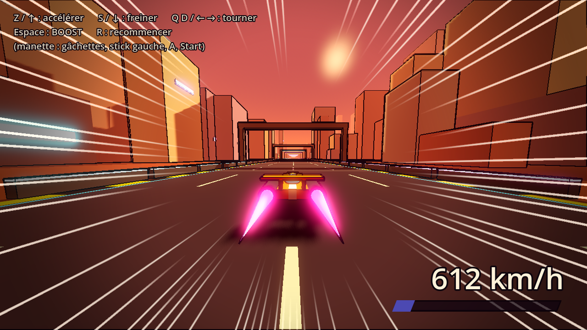
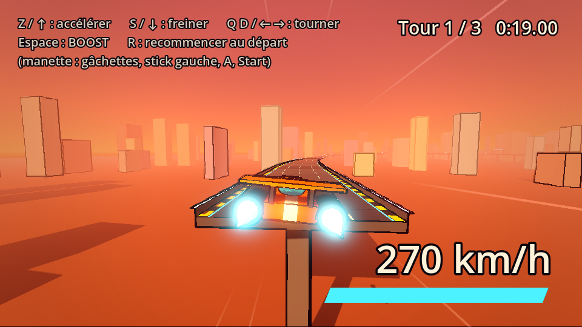

# Jeu de Course

Jeu de course SF d'Eric et Willy : un univers original, déjanté, stylisé et un peu grunge, dans l'esprit de *Redline*, du Motorball d'*Alita* et de *Borderlands*. L'ossature s'inspire de *Star Wars: Galactic Racer*.

Le document de conception (GDD) et les comptes rendus de session sont dans le dossier Google Drive « Projet jeu Eric & Willy ».

## Lancer le prototype

1. Ouvrir **Godot 4.7** et cliquer sur **Importer**.
2. Choisir le fichier `project.godot` de ce dossier.
3. Appuyer sur **F5** (ou sur le bouton ▶ en haut à droite).

## Commandes

| Action       | Clavier (AZERTY)    | Manette          |
|--------------|---------------------|------------------|
| Accélérer    | Z ou ↑              | Gâchette droite  |
| Freiner      | S ou ↓              | Gâchette gauche  |
| Tourner      | Q / D ou ← / →      | Stick gauche     |
| Boost        | Espace ou Maj       | A                |
| Recommencer  | R                   | Start            |

En QWERTY, ce sont les touches W A S D, à la même place.

## Ce que contient le prototype



Ce premier prototype sert à régler la **sensation de vitesse**. Il propose une ligne droite sans fin dans une ville industrielle au coucher du soleil, avec un bolide qui va de 270 km/h en vitesse normale à environ 610 km/h en boost.

Les effets qui donnent la vitesse :

- **Champ de vision qui s'élargit** avec la vitesse. C'est l'effet le plus fort.
- **Caméra qui décroche** un instant quand le boost démarre, puis rattrape le bolide.
- **Tremblements** en boost et lors des chocs contre les murets.
- **Lignes de vitesse façon anime** sur les bords de l'écran.
- **Marquages au sol, murets et portiques** qui défilent, comme repères visuels.
- **Son de moteur** qui monte dans les aigus, et souffle du boost.
- **Rendu cartoon** : éclairage en aplats et contours noirs façon BD.

## Circuits avec relief



La scène `scenes/circuit_essai.tscn` (à ouvrir puis lancer avec **F6**, « lancer la scène actuelle ») est un vrai circuit en boucle : montées, descentes, virages relevés, blocs à éviter, tremplin au-dessus d'un trou et passage sans muret. Si on tombe, on réapparaît un peu plus tôt sur la route. Un chrono compte les tours et garde le meilleur.

Tout le circuit est construit par le code à partir d'un petit fichier de données, `circuits/circuit_essai.gd` : une liste de points de passage vus de dessus (avec leur hauteur et leur dévers) et une liste d'obstacles placés par leur distance depuis le départ. Le mode d'emploi est en tête du fichier. Pour créer un nouveau circuit, on copie ce fichier, on change les points et les obstacles, et on indique le nouveau fichier dans le réglage `fichier_circuit` du nœud **Circuit**.

## Organisation des fichiers

```
project.godot           Réglages du projet (scène de départ, fenêtre…)
circuits/
  circuit_essai.gd      Le tracé et les obstacles du circuit d'essai
scenes/
  main.tscn             La scène principale : décor, caméra, son, affichage
  circuit_essai.tscn    Un vrai circuit avec relief et obstacles
  vehicule.tscn         Le bolide (formes simples, à remplacer par un vrai modèle)
scripts/
  commandes.gd          Les touches clavier et manette
  vehicule.gd           Conduite, boost, animations du bolide
  camera_poursuite.gd   Caméra et effets de vitesse
  decor_base.gd         Ce que partagent tous les décors (effets du boost)
  circuit.gd            Construction de la ligne droite par le code
  circuit_trace.gd      Construction d'un circuit à partir d'un fichier de données
  son_moteur.gd         Son de moteur généré en direct
  hud.gd                Compteur, jauge de boost, lignes de vitesse
shaders/
  toon.gdshader         Matière cartoon des objets
  contours.gdshader     Contours noirs sur toute l'image
  route.gdshader        Marquages de la piste
  route_circuit.gdshader  Marquages qui suivent les virages des circuits
  lignes_vitesse.gdshader  Lignes de vitesse à l'écran
```

## Bidouiller les réglages

Presque tous les réglages sont modifiables dans l'éditeur, sans toucher au code. Il suffit de cliquer sur un nœud de la scène et de regarder l'**Inspecteur** à droite :

- **Vehicule** : vitesses, accélération, maniabilité, durée du boost.
- **Camera** : champ de vision minimum et maximum, distance, recul.
- **Circuit** : `graine` (change le tirage du décor) et nombre de bâtiments.

Changez une valeur, relancez avec F5 et comparez. C'est la meilleure façon de comprendre ce que fait chaque réglage.
